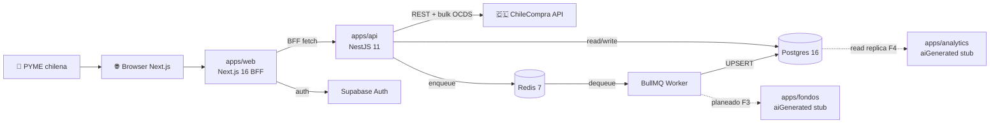
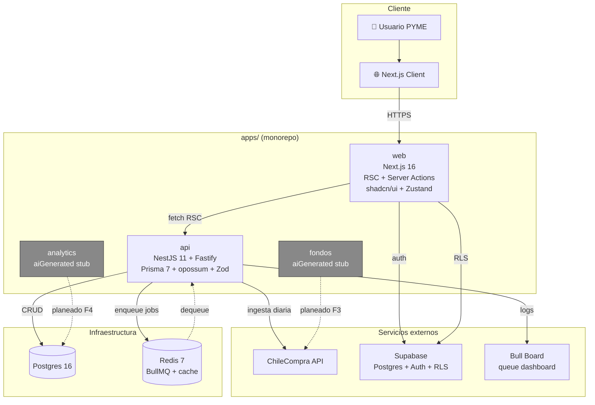
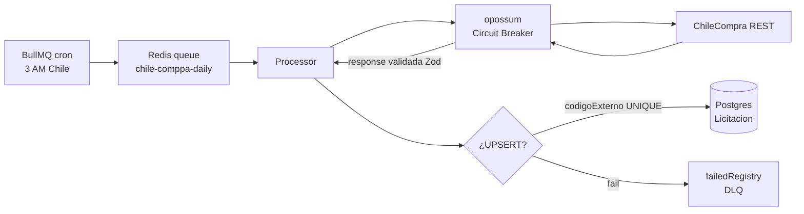
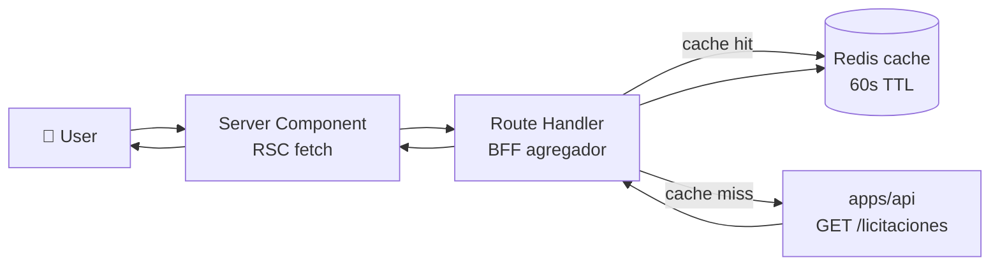

# Diagramas de Componentes (Flowcharts)

> Propósito: mapa estable del sistema. Actualizar solo si cambia topología.

## Contexto (alto nivel)

## Componentes principales

## Flujo de datos: ETL ChileCompra

## Flujo de datos: BFF Web → API

